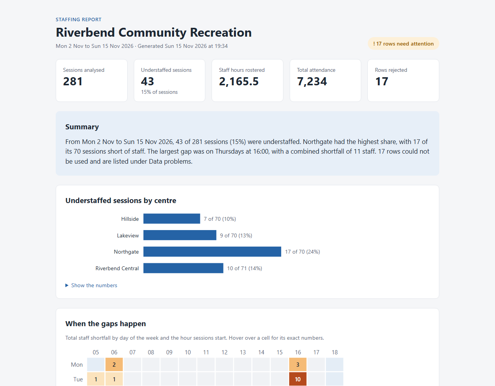
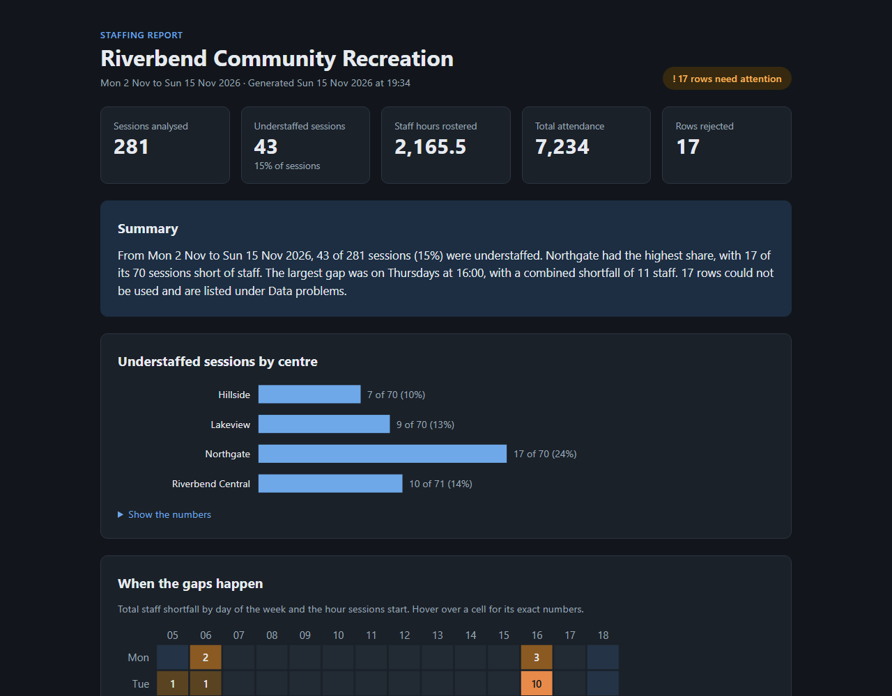

# Roster Check

Roster Check compares who was rostered on with who turned up, and shows which sessions did not have enough staff.

It is written for a fictional organisation, "Riverbend Community Recreation", which runs swim lessons, gym sessions and fitness classes across four centres. Every week someone would otherwise check the staff roster against session bookings by hand. Roster Check reads the two spreadsheets a centre already exports, checks every session against simple staffing ratios (for example, one swim instructor for every eight swimmers), and produces a one-page report that a centre manager can open in any web browser. The report shows how many sessions were understaffed, which centres and times were worst, and every spreadsheet row it could not use, with the reason, so the data can be fixed.

All data in this project is invented.

<picture>
  <source media="(prefers-color-scheme: dark)" srcset="docs/images/report-dark.png">
  
</picture>

## What the report shows

- **Headline numbers:** sessions analysed, understaffed sessions, staff hours rostered, total attendance, and rows that could not be used.
- **A summary in plain English.** Optionally, a short summary written by Claude instead (see [Optional AI summary](#optional-ai-summary)).
- **Understaffed sessions by centre,** as a bar chart.
- **When the gaps happen:** a day-by-hour grid of the combined staff shortfall.
- **Attendance and staff hours over time.**
- **The ten worst understaffed sessions,** each described in words, such as "Needs 3 swim instructors, had 1".
- **Data problems:** every rejected row with its line number, the row as written, and why it was rejected, plus rows that were cleaned or flagged.
- **How the numbers were calculated,** including the staffing rules used.

The report is a single HTML file. It works offline, makes no requests to other websites, follows the reader's light or dark setting, and prints on two A4 pages.

| Light | Dark |
|---|---|
|  |  |

## Quick start

Requires [uv](https://docs.astral.sh/uv/).

```bash
uv sync
uv run roster-check
```

With no options it runs on the bundled sample data, writes `roster-check-report.html` in the current folder and prints a short summary:

```
rosters.csv: 557 rows read, 9 rejected, 1 auto-fixed, 1 blank line skipped
sessions.csv: 289 rows read, 8 rejected, 1 auto-fixed, 1 flagged, 1 blank line skipped
Understaffed sessions: 43 of 281 (15%)
Report written to roster-check-report.html
```

Open the report in any browser, or add `--open` to have the tool open it. Without uv, `pip install .` followed by `roster-check` works too.

To check your own files:

```bash
uv run roster-check --rosters my_rosters.csv --sessions my_sessions.csv --out report.html
```

| Option | What it does |
|---|---|
| `--rosters PATH` | Roster CSV file. Defaults to the bundled sample. |
| `--sessions PATH` | Session CSV file. Defaults to the bundled sample. |
| `--rules PATH` | Staffing rules CSV file. Defaults to the bundled rules. |
| `--out PATH` | Report file to write, replacing any existing one. Defaults to `roster-check-report.html`. |
| `--db-file PATH` | Also save the DuckDB database, with its tables and analysis views, to this file. |
| `--summarise` | Add a short AI-written summary from Claude. See below. |
| `--strict` | Exit with code 1 if any row was rejected. |
| `--open` | Open the report in the default browser. |
| `--debug` | Show the full traceback when something goes wrong. |
| `--version` | Print the version and exit. |

Exit codes:

| Code | Meaning |
|---|---|
| `0` | Success. |
| `1` | An unexpected error, or `--strict` found rejected rows. |
| `2` | An input or output problem: an input file that cannot be used (no report is written), an output folder that does not exist, a report or database file that cannot be written, or `--out` and `--db-file` naming the same file. |

### Optional AI summary

With `--summarise`, the report's summary panel shows a 3 to 5 sentence summary written by Claude, labelled as AI-generated. It needs the optional `ai` extra and an Anthropic API key:

```bash
uv sync --extra ai
export ANTHROPIC_API_KEY=your-key    # PowerShell: $env:ANTHROPIC_API_KEY = "your-key"
uv run roster-check --summarise
```

Only aggregated figures are sent: counts, centre names, activities, days and times. Staff names, staff IDs and session IDs are never sent. The model defaults to `claude-opus-5-5` and can be changed with `ROSTER_CHECK_MODEL`. Without a key or the extra, or if the request fails, the tool says so in one line and the report keeps its standard summary with a short note.

## How it works

The tool is a short pipeline of small modules. Data flows one way:

```
CSV files -> ingest -> validate -> db (DuckDB) -> analysis (SQL) -> charts -> report -> HTML file
                          |                                                   ^
                          +--------------- rejected rows ---------------------+
```

1. **Ingest** reads each CSV file as text, keeping every row's line number and exact wording. It copes with Excel exports (byte-order mark, Windows line endings), blank lines, columns in any order and files that are not valid UTF-8. A missing file, an empty file or a missing column stops the run with a one-line message.
2. **Validate** checks every row against fixed rules: required fields, real dates in Australian (`DD/MM/YYYY`) or ISO format, times, whole numbers, known centres, roles and activities, and duplicate IDs. Each rejected row gets one plain-English reason, such as "Date 2026-02-30 does not exist". Stray spaces and capitals are cleaned and noted. Attendance above capacity is kept but flagged.
3. **Database:** valid rows are loaded into an in-memory DuckDB database with bound parameters.
4. **Analysis** is plain SQL in `src/roster_check/sql/`, written as views. A session needs `max(minimum staff, ceil(attendance / participants per staff))` staff of each role. A staff member counts when one shift on the same day, at the same centre and in the right role, covers the whole session. The shortfall is the sum over roles of the staff missing.
5. **Charts** are hand-built SVG, with no chart library.
6. **Report** renders one HTML page with Jinja2, with the stylesheet and script inlined.

The command line is the only part that prints or writes files. Users never see a Python traceback unless they pass `--debug`.

### How this maps to a modern data stack

Roster Check is a small version of a common warehouse setup. In a real deployment, the roster and booking exports would land in BigQuery, and the SQL views in `src/roster_check/sql/` would carry over almost unchanged as BigQuery views. Dagster would run the same steps as assets on a weekly schedule: raw tables, validated tables with the rejected rows as a data quality check, the analysis views, and the report. The `--db-file` option already saves the tables and views to a DuckDB file, so a BI tool such as Evidence.dev can read the same logic.

Airbyte is deliberately not used. It is built to sync many SaaS systems and databases into a warehouse, and self-hosting it means running several services with gigabytes of memory, which is far more than two local CSV files need and would break the "runs with almost no setup" goal. In a real deployment, the ingest step is where Airbyte or a similar connector would plug in, landing the roster and booking exports in the warehouse before the same SQL runs.

## Sample data

The package bundles fictional data for the four centres of "Riverbend Community Recreation", covering Monday 2 to Sunday 15 November 2026. It is in `src/roster_check/data/`:

| File | Contents |
|---|---|
| `centres.csv` | The four known centres. |
| `staffing_rules.csv` | How many staff of each role each activity needs. |
| `sample/rosters.csv` | 557 roster rows. Saved as an Excel export would be, with a byte-order mark and Windows line endings. |
| `sample/sessions.csv` | 289 session rows with capacity and attendance. |

The two sample files are generated by a seeded script, so the same files are produced every time:

```bash
uv run python scripts/make_sample_data.py
```

They deliberately contain about 20 bad rows, such as blank fields, impossible dates, unknown roles and duplicate IDs, so the report's data problems section always has something to show. Staffing is mostly adequate, with understaffing concentrated in a few patterns, for example weekday after-school swim lessons at Northgate. All names and IDs are invented.

## How this was built

This project was built with the assistance of Claude Code, Anthropic's coding agent, working under rules I set and reviewed at every step.

- **Specification first.** Before any code, I wrote a [project brief](documentation/Roster%20Check%20-%20Project%20Brief.md) covering the data columns, every bad-data case and its exact message, the report's contents, each module's job, the testing approach and the milestone plan. A `CLAUDE.md` file gave the agent the working rules: stay inside the current milestone, write tests with every change, keep SQL in `.sql` files, never send staff details to the AI, and ask rather than guess.
- **One milestone at a time.** The work was split into nine milestones, from the project skeleton to this release. Each had its own branch and pull request, and was merged only when the previous one was done.
- **Decisions stayed with me.** When the brief did not settle something, the agent stopped and asked. I made the call, and it went into the brief's decision log (D1 to D40), for example how the terminal summary reads, separating flagged rows from auto-fixed ones, and the exact wording of the Claude prompt.
- **Nothing was committed without my approval.** The agent showed me the files and the proposed message for approval or amendment before committing. Every commit, push, pull request and merge needed my review and confirmation.
- **Automated review.** In addition to my manual reviews, CodeRabbit reviewed every pull request against project-specific guidance. Every comment was answered with a fix or a stated reason. Where CodeRabbit pushed a fix itself, it was checked before merging.
- **Automated checks.** GitHub Actions runs ruff, the full test suite with a 90 percent coverage gate, and the tool itself on Linux (Python 3.11 to 3.13), Windows and macOS for every push. Tests never use the network or the real Anthropic API.
- **Manual checks.** The report was checked by hand for accuracy and clarity, including testing in several browsers and on different devices.

## Development

```bash
uv sync --all-extras          # runtime, dev and optional dependencies
uv run pytest --cov           # tests with coverage
uv run ruff check             # lint
uv run ruff format --check    # formatting
```

## Licence

MIT. See [LICENSE](LICENSE).
